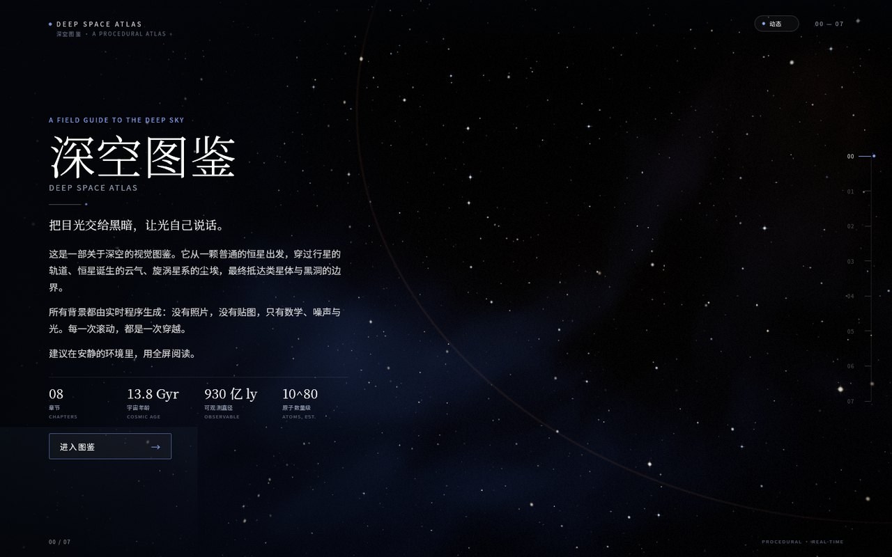
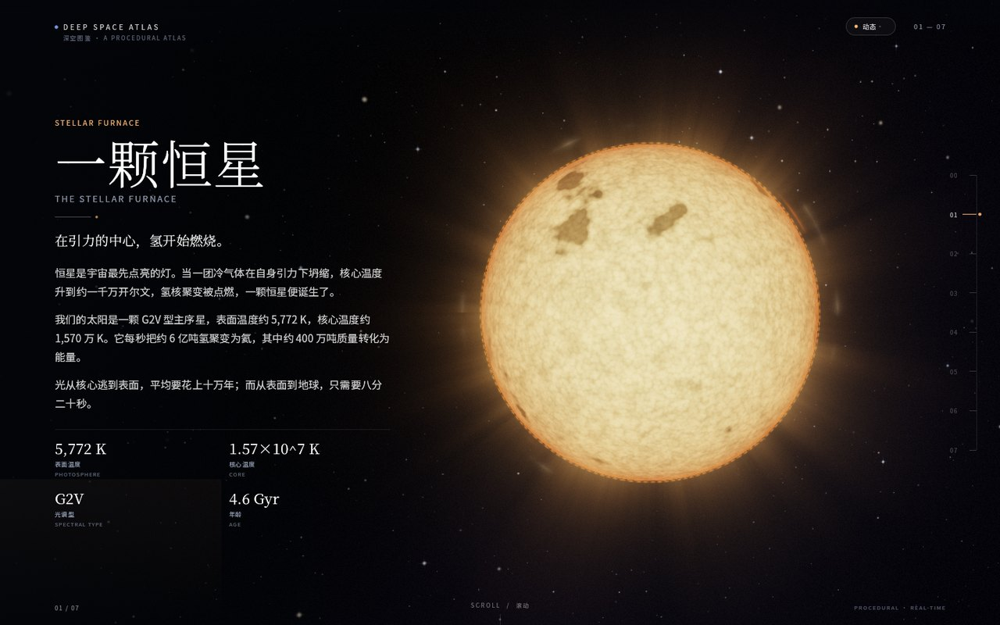
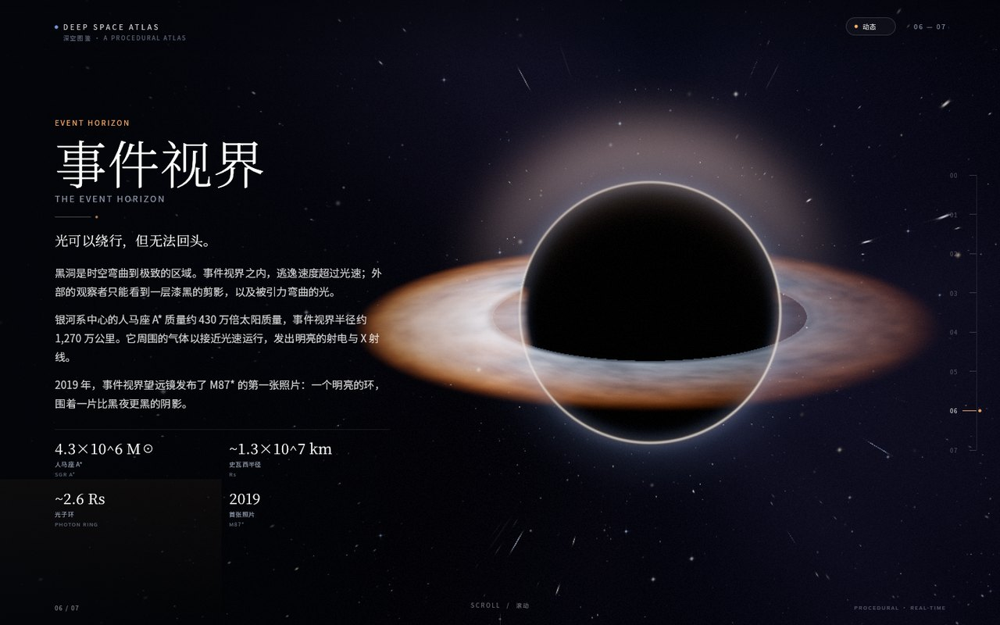
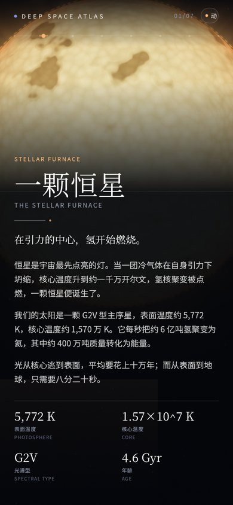

# 深空图鉴 · Deep Space Atlas

A field guide to the deep sky, drawn in real time by Rust, egui and WebGPU.

Eight full-screen chapters move from a single star to the edge of a black hole.
There are no photographs, textures or video files: every background is a
procedural WebGPU scene, and every title, paragraph and figure is laid out by
egui. The result is a quiet, book-like reading experience that still behaves
like a modern web application.



---

## Contents

- [What it is](#what-it-is)
- [Screens](#screens)
- [Design philosophy](#design-philosophy)
- [Tech stack](#tech-stack)
- [Architecture](#architecture)
- [Directory structure](#directory-structure)
- [Run it](#run-it)
- [Build a static bundle](#build-a-static-bundle)
- [Browser requirements](#browser-requirements)
- [The fallback page](#the-fallback-page)
- [Extending the atlas](#extending-the-atlas)
- [Performance notes](#performance-notes)
- [Accessibility and motion](#accessibility-and-motion)
- [Verification](#verification)
- [Assets and licenses](#assets-and-licenses)
- [License](#license)

---

## What it is

- **Eight chapters** — prologue, star, planetary system, nebula, galaxy, quasar,
  black hole, epilogue.
- **One vertical gesture** — a wheel, a swipe, `PageUp` / `PageDown`, arrow keys,
  `Home` / `End`, the chapter rail, or the cover button.
- **A real state machine** — pages are never scrolled. A page transition blends
  two procedural scenes, moves and gently scales both text layers, and settles
  on an integer index in about 780 ms.
- **A deliberate art direction** — deep blue-black, cool light, sparse warm
  accents, hairlines, generous negative space, and Chinese display type paired
  with a small English voice.
- **A friendly failure mode** — if WebGPU or a secure context is unavailable,
  the canvas is replaced by a styled, readable fallback instead of a blank
  screen.

The project is a front-end capability study: it tests how far a pure
Rust/egui/WebGPU stack can be pushed toward an editorial, non-dashboard web
experience.

## Screens

| Star | Black hole |
| --- | --- |
|  |  |

| Mobile reading view |
| --- |
|  |

The screenshots above are captured from the local build at 1440 × 900 and
390 × 844. The backgrounds are live WebGPU frames, not static art.

## Design philosophy

**The atlas is a place, not a dashboard.** Each chapter is a full viewport. There
are no cards, sidebars or nested scroll areas. Navigation is a single vertical
gesture, and the page indicator is a quiet rail rather than a navigation bar.

**Darkness is the material.** The base is `#04060B`. Scenes are built from
sparse highlights instead of a bright poster. Text sits on a soft scrim so it
stays readable over a star, a nebula or an accretion disk without turning the
page into a black box.

**Science with restraint.** Figures are rounded, sourced from consensus values
and written in short, declarative sentences. The copy avoids false precision,
mythology and breathless adjectives. The art is stylised, but the numbers are
not.

**Motion should explain, not decorate.** A transition moves the outgoing page
out and the incoming page in while the background cross-blends. The movement is
short, eased and interruptible by reduced-motion preferences. Particles drift;
they do not chase the cursor.

More detail: [`docs/DESIGN.md`](docs/DESIGN.md).

## Tech stack

| Layer | Choice |
| --- | --- |
| Language | Rust 2024, MSRV 1.95 |
| Windowing and UI | `eframe` 0.37 / `egui` 0.37 |
| GPU | `wgpu` 30, WebGPU on the web and native wgpu on desktop |
| Web build | `wasm-bindgen`, `wasm-bindgen-futures`, Trunk 0.21 |
| Background art | One custom WGSL scene shader, offscreen HDR targets, quarter-resolution bloom, ACES-like composite |
| Type | Subsetted Noto Serif SC Light / Regular and Noto Sans SC Regular (SIL OFL 1.1) |
| DOM | A canvas plus a boot overlay and a no-WebGPU fallback; no React/Vue and no HTML-template UI |

The interface is drawn entirely with egui shapes and galleys. The DOM is only a
host for the canvas and the pre-boot / failure chrome.

## Architecture

```text
index.html
  ├─ #atlas-canvas                 the only rendering surface
  ├─ boot overlay                  fades out when the app is ready
  ├─ no-WebGPU fallback            visible before wasm if navigator.gpu is absent
  └─ Trunk wasm loader
          │
          ▼
src/main.rs
  ├─ native: eframe::run_native
  └─ wasm:   WebGPU guard → eframe::WebRunner → AtlasApp
          │
          ▼
src/app/mod.rs  (AtlasApp)
  ├─ clock, boot fade, pointer smoothing
  ├─ input::Navigation            wheel / keys / touch swipe
  ├─ motion::MotionPreference     OS preference + manual override
  ├─ adaptive render scale        frame-time hysteresis
  ├─ transition::PageTransition   from → to, elapsed, duration
  ├─ SceneFrame                   palette, cameras, phases, veil, composition
  └─ BackgroundCallback           inserted into the egui paint list
          │
          ├─ src/ui/              scrim, type, stats, rail, CTA, motion toggle
          ├─ src/content/         eight Page values
          └─ src/scenes/          SceneId, CameraPose, SceneSpec, SCENES
                  │
                  ▼
src/render/gpu.rs  (SceneRenderer)
  ├─ scene pass       full-screen WGSL → Rgba16Float
  ├─ downsample       soft-threshold bloom extraction → quarter res
  ├─ blur H / V       5-tap separable Gaussian ping-pong
  └─ composite        scene + bloom, veil, ACES, vignette, sRGB, grain
```

The only type that crosses into egui is `BackgroundCallback`. The UI never sees
wgpu, and the renderer never sees text.

### Frame lifecycle

1. eframe calls `App::ui`.
2. The app advances its clock, polls `prefers-reduced-motion`, reads wheel,
   keyboard and touch events, and updates the page transition.
3. It builds a `SceneFrame` and appends `Callback::new_paint_callback(...)` to
   the root painter **before** any interface shapes.
4. egui's wgpu renderer calls `prepare` for every callback. The renderer draws
   the scene into an offscreen texture, extracts and blurs bloom, then returns
   an empty command buffer.
5. During the main egui pass, `paint` draws the composite into the callback
   rect. The scrim, galleys, rail and controls are then drawn on top in the
   same layer.
6. The app requests the next repaint at roughly 60 Hz.

### Uniform layout

`src/render/uniform.rs` is the contract between CPU and WGSL: fifteen `vec4`
rows (240 bytes) — resolution, modes, two palettes, two cameras, two accents,
pointer/motion, post constants, phases/veil, output size, texel sizes,
composition/mobile and flags. A compile-time assertion keeps the size honest.

## Directory structure

```text
.
├── Cargo.toml                  crate metadata, features, lints
├── Cargo.lock
├── Trunk.toml                  Trunk target/dist and watcher ignores
├── index.html                  canvas, boot sequence, fallback, DPR canvas fit
├── .cargo/config.toml          web_sys_unstable_apis for wasm32
├── assets/fonts/
│   ├── NotoSerifSC-Light.ttf   subset, display titles
│   ├── NotoSerifSC-Regular.ttf subset, lead / figures
│   ├── NotoSansSC-Regular.ttf  subset, body / labels
│   └── OFL.txt                 SIL Open Font License 1.1
├── docs/
│   ├── ARCHITECTURE.md         deeper implementation notes
│   ├── DESIGN.md               visual system and scene direction
│   ├── DEPLOY.md               static hosting and WebGPU notes
│   └── screenshot-*.jpg        local-build screenshots
├── examples/preview.rs         headless wgpu renderer → preview PNGs
├── src/
│   ├── main.rs                 native / wasm entry points
│   ├── lib.rs                  module map and layer contract
│   ├── app/
│   │   ├── mod.rs              AtlasApp, clock, callback, adaptivity
│   │   ├── input.rs            Navigation state machine
│   │   ├── motion.rs           reduced-motion preference
│   │   └── platform.rs         wasm-only DOM and WebGPU bridge
│   ├── content/mod.rs          PAGES, Page, Stat
│   ├── scenes/mod.rs           SceneId, CameraPose, SceneSpec, SCENES
│   ├── render/
│   │   ├── mod.rs              public render API
│   │   ├── gpu.rs              pipelines, targets, callback
│   │   ├── uniform.rs          SceneFrame → FrameUniform
│   │   └── shaders/atlas.wgsl  scene, bloom and composite WGSL
│   ├── transition/mod.rs       state machine and text visuals
│   └── ui/
│       ├── mod.rs              scrim, chrome, rail, hint, actions
│       ├── fonts.rs            bundled families
│       ├── theme.rs            colours, metrics, type scale
│       ├── page.rs             galley cache, fit, page painting
│       └── widgets.rs          text and gradient primitives
├── AGENTS.md                   local-only agent guide (gitignored)
└── src/**/AGENTS.md            local-only module guides (gitignored)
```

`AGENTS.md` files are intentionally **not** version-controlled. They are
working notes for coding agents; user-facing documentation stays in `README.md`,
`CONTRIBUTE.md`, `TODO.md`, `CHANGELOG.md` and `docs/`.

## Run it

### Prerequisites

- Rust 1.95 or newer (`rustup update stable`).
- The wasm target: `rustup target add wasm32-unknown-unknown`.
- Trunk 0.21+ (`cargo install trunk` or the prebuilt binary).
- A WebGPU-capable browser. Chrome / Edge 113+, Safari 26+, or a recent
  Firefox with WebGPU enabled.
- The page must be served over **HTTPS** or **localhost** for WebGPU.

### Development server

```bash
trunk serve
# http://127.0.0.1:8080/
```

The first run downloads `wasm-bindgen` automatically. Trunk watches `src/`,
`index.html`, the shader and the font files.

### Native window

The same application also runs as a desktop window for quick visual checks:

```bash
cargo run --release
```

Native rendering uses wgpu with the platform's primary backend (DX12 on
Windows, Metal on macOS, Vulkan on Linux). The native window is not the primary
target, but it is useful for shader iteration without a browser.

### Headless shader preview

`examples/preview.rs` renders every scene to `preview/scene-NN.png` with a real
wgpu device, without a window or browser:

```bash
cargo run --release --example preview -- 1600 900
# or a single scene index (0..7):
cargo run --release --example preview -- 1600 900 6
```

This is the fastest way to inspect a shader change. The preview uses a full
render scale and the same composite as the web build.

## Build a static bundle

```bash
trunk build --release
# output: dist/
```

`dist/index.html`, the hashed JS, and the hashed `.wasm` are self-contained.
No external fonts, images or CDNs are requested at runtime.

A production host should serve `.wasm` as `application/wasm` and enable gzip or
brotli. See [`docs/DEPLOY.md`](docs/DEPLOY.md) for GitHub Pages, Netlify and
Cloudflare Pages notes.

## Browser requirements

| Requirement | Why |
| --- | --- |
| WebGPU (`navigator.gpu`) | The scene shader and bloom pipeline run on a WebGPU device |
| Secure context | WebGPU is only exposed on HTTPS, localhost and `file://` in some browsers |
| ES2020 + WebAssembly | Trunk's loader and wasm-bindgen output |
| `devicePixelContentBoxSize` | eframe uses it to size the backing store; `index.html` also re-asserts the DPR size as a fallback |

The app checks WebGPU in JavaScript before the wasm boots and again in Rust
before starting eframe. If either check fails, the fallback page is shown.

### Why not WebGL2?

eframe and wgpu can fall back to WebGL2, but this atlas is explicitly a WebGPU
project: its HDR scene targets, storage-free but multi-pass bloom chain and
custom WGSL are designed around WebGPU. Rather than silently downgrading the
look, unsupported browsers get a clear, styled explanation and browser links.

## The fallback page

The fallback lives in `index.html` and is styled with system fonts so it is
available before the wasm bundle loads. It explains:

- that the atlas needs WebGPU;
- that HTTPS or localhost is required;
- which browser versions support WebGPU;
- where to check support (`caniuse.com/webgpu`, `webgpureport.org`).

If eframe fails after a successful capability check (for example, no adapter),
Rust adds the same `no-webgpu` class and the fallback appears instead of a
blank canvas.

## Extending the atlas

### Add or edit a chapter

1. Edit `src/content/mod.rs`. Each `Page` has a `SceneId`, chapter number,
   kicker, Chinese title, English title, lead, 2–4 paragraphs, 2–4 `Stat`s and
   an interface accent.
2. Keep the copy short and factual. Each paragraph should fit in roughly three
   lines at the desktop measure.
3. If you introduce new Chinese characters, the bundled font subsets must be
   regenerated (see below); otherwise egui falls back and may render tofu.
4. `PAGE_COUNT` is derived from `PAGES`, so the rail, counter, keyboard clamp and
   progress labels update automatically. The cover’s `NN — 07` label assumes
   eight pages; update the label text if you add a ninth.

### Add a scene

1. Add a variant to `SceneId` and a `mode()` index in `src/scenes/mod.rs`.
2. Add a `SceneSpec` to `SCENES` with a linear palette, accent, camera pose,
   drift rate and phase.
3. Add a `scene_<name>` function to `src/render/shaders/atlas.wgsl` and dispatch
   it from `scene_at`.
4. Add a `Page` in `content` whose `scene` is the new variant.
5. Render it with the headless preview and check the browser console for WGSL
   validation errors.

The shader contains eight modes in one module. Keep it that way: one pipeline,
one bind-group layout, no per-scene Rust plumbing.

### Regenerate the fonts

The repository ships only the glyphs currently used. To add copy:

```bash
# 1. Install the tools (Python 3.10+):
python -m pip install fonttools brotli

# 2. Download the variable fonts:
#    https://github.com/google/fonts/tree/main/ofl/notosanssc
#    https://github.com/google/fonts/tree/main/ofl/notoserifsc

# 3. Instantiate the weights and subset to the used characters.
#    See the comment block in src/ui/fonts.rs and the commands in CONTRIBUTE.md.
```

The display family uses the Light serif; the lead and statistics use the
Regular serif; body and labels use the Regular sans. All three are SIL OFL 1.1
and are credited below.

## Performance notes

- **One shader, eight modes.** There is no pipeline switch between pages; the
  scene mode is a uniform. Transitions render two modes and cross-blend them.
- **Offscreen HDR.** The scene renders to `Rgba16Float`, then bloom is extracted
  and blurred at quarter resolution. The final composite is a single full-screen
  pass with an ACES-like shoulder and a subtle vignette.
- **Adaptive resolution.** The scene render scale starts at 0.82 on desktop and
  0.62 on mobile. A frame-time controller with hysteresis moves it between 0.55
  and 0.90. The uniform `quality` value also skips the finest star-surface octave and
  thins resolved stars / nebula sparkle on mobile.
- **No nested scroll.** The wheel is accumulated and debounced; a single gesture
  cannot skip multiple chapters. Touch uses displacement plus a small velocity
  allowance.
- **Procedural only.** No large images, no network texture requests, no font
  CDNs. The wasm bundle is dominated by eframe, wgpu and egui; the fonts add
  roughly 700 KB before compression.
- **DPR-aware canvas.** `index.html` re-asserts the device-pixel canvas size
  after layout so high-DPI screens do not halve the egui viewport. The scene
  render scale is applied on top of that.

If you need a smaller wasm bundle, enable Trunk’s `wasm-opt` integration
(`data-wasm-opt="z"` on the Rust link) and install Binaryen. It is intentionally
not required for a successful build.

## Accessibility and motion

- **Reduced motion** follows the OS `prefers-reduced-motion` setting, polled once
  per second. The `M` key or the top-right pill toggles a manual override.
  Reduced mode shortens transitions to ~220 ms, disables parallax and pauses
  time-based drift and twinkling.
- **Keyboard** — `ArrowDown` / `ArrowRight` / `PageDown` / `Space` next;
  `ArrowUp` / `ArrowLeft` / `PageUp` previous; `Home` / `End` jump.
- **Touch** — vertical swipe up/down.
- **Progress rail** — every chapter tick is clickable; the mobile rail is a
  horizontal row under the top bar.
- **Screen readers** — the canvas `aria-label` is updated with the current
  chapter number and title. The document title stays stable.
- **No text overflow** — the page block measures its galleys and tries a series
  of scales (1.0 → 0.70), then a compact variant. On mobile the text sits on a
  deep reader’s scrim; the scene remains visible above it.
- **No autoplay audio**, no flashing, no rapid color cycling.

## Verification

The following checks were run locally on Windows with Rust 1.95, Chrome 155 and
a discrete GPU:

```bash
cargo fmt --check
cargo clippy --all-targets -- -D warnings
cargo check --target wasm32-unknown-unknown
trunk build --release
cargo run --release --example preview -- 1600 900
```

Also exercised in a real browser:

- boot from `trunk serve` and `trunk build --release` output;
- all eight chapters via arrow keys, wheel, `Home` / `End`, rail clicks and touch
  swipes;
- cover CTA, motion toggle, transition midpoints;
- mobile layout at 390 × 844 and high-DPI canvas sizing;
- the no-WebGPU fallback (by removing `navigator.gpu` before load).

**Build note.** No subagents were used for this implementation. The environment
could not guarantee that a subagent would run the exact same model, so the
architecture, code, shader art direction and documentation were all produced
serially by the primary agent. This keeps the visual language and module
boundaries consistent.

## Assets and licenses

- **Noto Serif SC** — Copyright 2014–2021 Adobe, with Reserved Font Name
  “Source”; SIL Open Font License 1.1. Subsetted for this project.
- **Noto Sans SC** — Copyright 2014–2021 Adobe, with Reserved Font Name
  “Source”; SIL Open Font License 1.1. Subsetted for this project.
- The full license text is in [`assets/fonts/OFL.txt`](assets/fonts/OFL.txt).
- All backgrounds, icons and decorative marks are generated procedurally in
  WGSL or drawn with egui. No third-party images are bundled.
- The favicon is an inline SVG data URI in `index.html`.

## License

The source code is released under the [MIT License](LICENSE).
